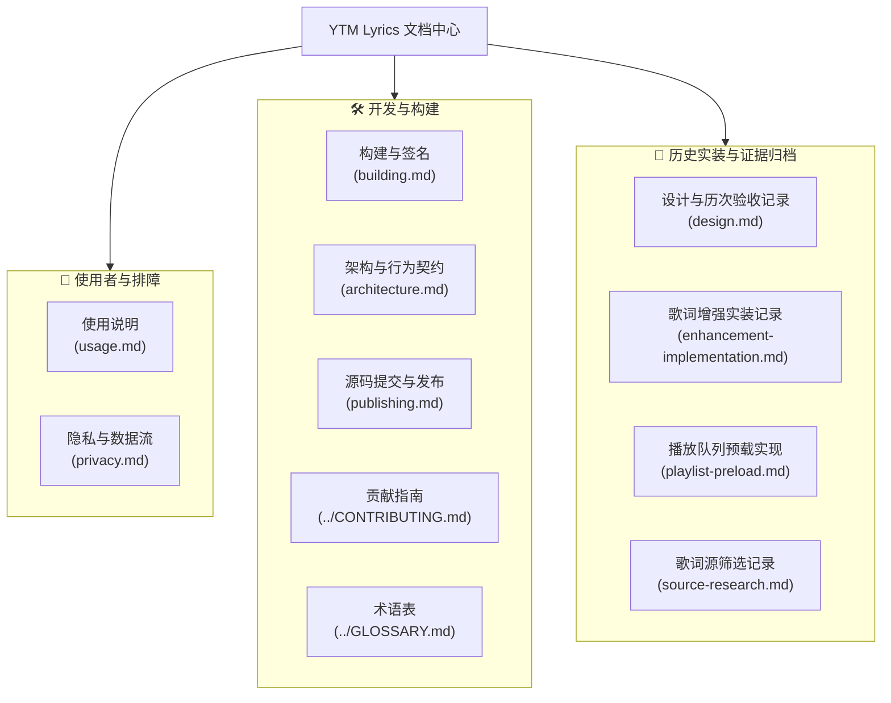

# YTM Lyrics 文档中心 (Documentation Hub)

欢迎来到 YTM Lyrics 文档中心。本项目文档按照系统分层、使用场景与开发生命周期分类组织。

---

## 快速导航索引

---

## 活跃文档矩阵

| 文档名称 | 目标读者 | 核心内容 | 维护状态 |
| --- | --- | --- | --- |
| [使用说明](usage.md) | 普通用户 / 测试者 | 交互入口、逐字动效、流动背景、本曲偏移、来源择优、预载机制与 FAQ 排错 | **当前活跃 (v0.6.0)** |
| [隐私与数据流](privacy.md) | 所有关注隐私者 | 网络请求范围、无凭据传输保证、本地 SharedPreferences 结构、沙箱 CSP 隔离 | **当前活跃** |
| [构建与签名](building.md) | 开发者 / 编译者 | JDK 17 与 SDK 36 要求、Windows/Linux 编译脚本、AMLL 离线生成、维护者签名 | **当前活跃** |
| [架构与行为契约](architecture.md) | 开发者 / 架构师 | 拓扑分层、MediaSession 进度时间轴、互斥挂载、WebView 恢复状态机、版本隔离 | **当前活跃** |
| [源码提交与发布](publishing.md) | 维护者 / 贡献者 | Git 特性分支规范、手动 GitHub CI 验证、正式 Release 检查单 | **当前活跃** |
| [参与开发](../CONTRIBUTING.md) | 开源贡献者 | 模块分层放置规则、代码规范、测试要求、问题反馈模板 | **当前活跃** |
| [术语表](../GLOSSARY.md) | 所有开发者与使用者 | 统一专业术语定义（如逐字歌词、自动择优、手动绑定、互斥挂载等） | **当前活跃** |
| [更新记录](../CHANGELOG.md) | 所有关注者 | 各版本的详细特性变更、体验改进与修复记录 | **持续更新** |

---

## 历史实装与证据归档

以下文档作为项目开发演进的历史档案保留，记录了当时的设计草案、静态定位依据与电脑验证证据。旧版本的个别界面或细节不能作为当前版本的最终行为：

- [设计与历次验收记录](design.md)：0.1.0 ~ 0.6.0 各阶段的需求分析、架构决策与阶段性验收。
- [歌词增强实装记录](enhancement-implementation.md)：0.3.0 ~ 0.6.0 接入 AMLL、QRC/YRC 逐字解密、互斥挂载、限次恢复、手动偏移及 WebGL 流动背景的具体技术实装。
- [按播放队列预载歌词实现记录](playlist-preload.md)：0.4.0 播放队列滚动预载机制的宿主模型定位与实现细节。
- [GitHub 歌词源实现筛选记录](source-research.md)：2026-10-18 对 Spotify_lyric、Cadence、Capsulyric 开源协议的筛选与评估过程。

> [!NOTE]
> 历史文档中提及的宿主反编译材料、设备数据导出与真实版权歌词抓取结果均不随公开仓库分发。

---

## 推荐阅读路径

### 如果你是普通用户：
1. 先阅读 [项目首页](../README.md) 了解环境兼容性（Android 16 / YTM 9.41.52 / Xposed API 102）。
2. 阅读 [使用说明](usage.md) 掌握设置菜单打开方式、时间轴微调与常见问题排查。
3. 查阅 [隐私与数据流](privacy.md) 了解数据安全与网络请求策略。

### 如果你是模块开发者：
1. 阅读 [构建与签名](building.md) 配置本地编译环境并跑通测试。
2. 阅读 [架构与行为契约](architecture.md) 理解 core 纯 Java 边界与 app 宿主 Hook 接缝。
3. 参考 [术语表](../GLOSSARY.md) 与 [参与开发](../CONTRIBUTING.md) 保持代码与文档规范一致。

### 如果你在适配新版 YouTube Music 宿主：
1. 重点研读 [架构与行为契约](architecture.md) 中的宿主挂载与按钮激活原理。
2. 参考 [歌词增强实装记录](enhancement-implementation.md) 中关于混淆类、方法签名与反射的定位历史。
