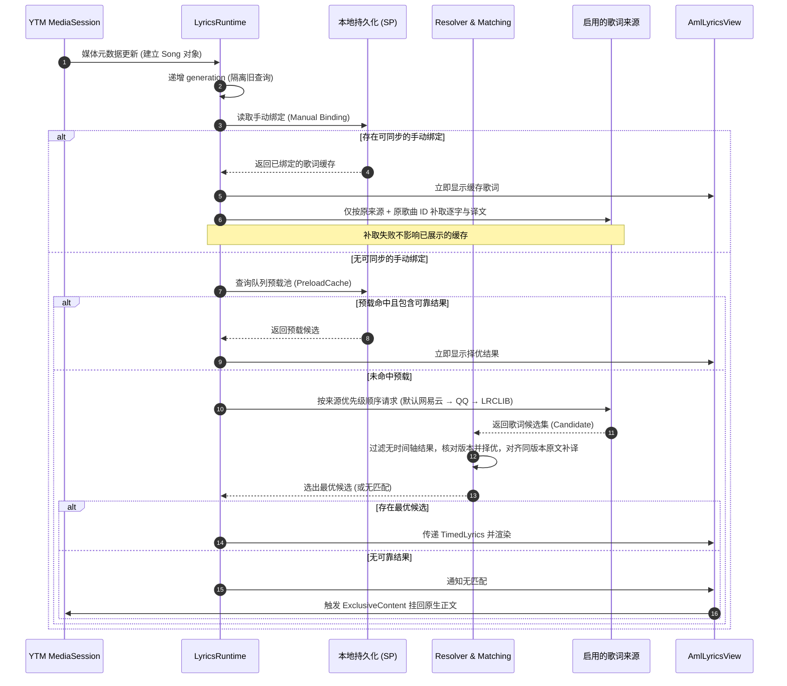
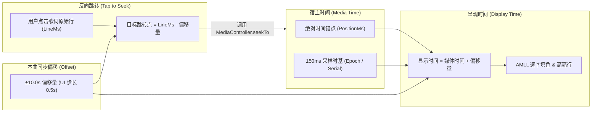
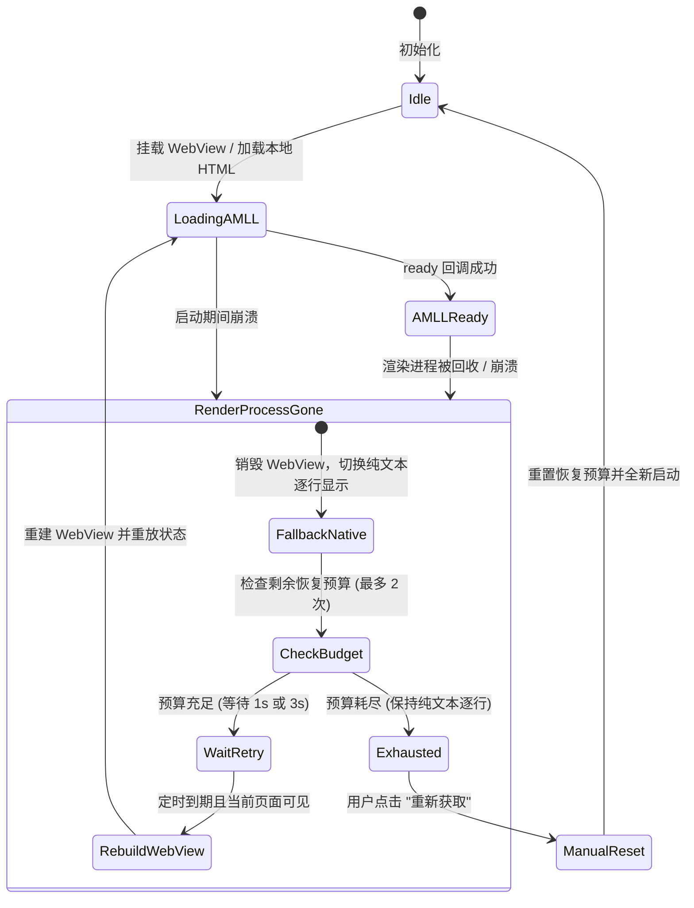

# 架构与行为契约

本文档详述 YTM Lyrics 的系统架构、模块分层、生命周期与核心行为契约。

## 模块拓扑与职责划分

系统划分为纯 Java 领域核心（`core`）、Android 与宿主交互层（`app`）以及离线渲染前端（`demo/src` 与生成的 WebBundle）。

```mermaid
flowchart TD
    subgraph YTM["YouTube Music 宿主环境 (API 36 / v9.41.52)"]
        MS["MediaSession & 播放队列"]
        NP["原生歌词页面 / Title ⋯"]
        LF["LoadingFrameLayout (原生正文)"]
    end

    subgraph App["app 模块 (Android & Xposed Hook)"]
        HR["LyricsRuntime (运行总线)"]
        QA["QueueAdapter (队列适配)"]
        EC["ExclusiveContent (互斥挂载器)"]
        RS["RendererSession (WebView 恢复管理)"]
        AE["ArtworkEncoder & ArtworkState"]
        BS[("BindingStore / PreloadCache / OffsetStore")]
    end

    subgraph Core["core 模块 (纯 Java，无 Android 依赖)"]
        SR["SourceRegistry (来源注册与排序)"]
        RES["Resolver & Matching (匹配与择优)"]
        PLP["PlaylistPreloader (队列滚动预载)"]
        TL["TimedLyrics & LyricsOffset (时间轴与偏移)"]
    end

    subgraph Render["AMLL 离线渲染层 (本地 WebView 沙箱)"]
        WV["AmlLyricsView (本地 HTML)"]
        AMLL["AMLL Core 0.6.0 (逐字填色 & 弹簧滚动)"]
        MGR["MeshGradientRenderer (封面网格渐变)"]
        FB["静态模糊底图 / 原生逐行回退"]
    end

    MS -->|媒体元数据 / 进度锚点 / 封面| HR
    MS -->|发布队列| QA
    QA -->|待播列表| PLP
    HR -->|歌曲变更 / 查询计划| SR
    SR -->|网络查询 (网易云 / QQ / LRCLIB)| RES
    RES -->|候选评级| TL
    HR -->|存取持久化数据| BS
    PLP -->|预载缓存| BS

    NP -->|劫持内容返回| EC
    EC -->|无匹配时挂回| LF
    EC -->|有自定义歌词时挂载| WV

    HR -->|时间锚点 + 偏移 / 封面 Revision| WV
    WV -->|驱动| AMLL
    WV -->|驱动| MGR
    RS -->|崩溃检测与限次重建| WV
    RS -.->|失败降级| FB
```

### 职责边界

| 模块 / 包 | 依赖约束 | 核心职责 |
| --- | --- | --- |
| `core` | 纯 Java 8/17，**严格禁止引入 Android SDK 或 Xposed** | `Song`、`Candidate`、`TimedLyrics` 领域模型；歌曲匹配与打分；时间戳转换；队列预载调度算法；来源接口抽象。 |
| `app/source` | Android 基本库、网络 transport | 对接网易云音乐、QQ 音乐和 LRCLIB，处理 YRC/QRC 及 LRC；负责配置序列化与本地存储。 |
| `app/hook` | modern libxposed API 102 | 精确适配固定宿主版本（`com.google.android.apps.youtube.music` 9.41.52 / 94152240）；拦截媒体会话、队列发布与歌词入口。 |
| `app/ui` | Android Views, WebView | `LyricsPanel` 容器排版；`ExclusiveContent` 互斥挂载；`RendererSession` 两次重建退避；统一设置弹窗。 |
| `demo/src` | AMLL Core 0.6.0, Rollup, WebGL | 独立前端离线 Bundle；封面流动网格背景；3 秒手动滚动恢复跟随补丁；宿主进程通信桥接。 |

---

## 核心业务流契约

### 1. 歌曲变更与歌词决议流程



旧绑定只有纯文本时不显示，也不删除记录；来源支持增强时先按原来源和歌曲 ID 补取同步歌词，仍无时间轴或失败时进入同步候选查询。`LyricsResults` 统一约束自动决议、手动候选与缓存读写；`Candidate.hasLyrics()` 仍表示原始数据是否含歌词，不改变旧绑定的解码与存储语义。

实时查询和预载命中使用同一选择规则。直接匹配可先显示；缺少直接匹配时，专辑或跨来源的原文时间轴提供额外证据，冲突则交由用户确认。跨来源佐证至少需要三条不同的原文行对齐，两侧各至少四分之三的行匹配。

选出主候选后，补译仍要求同歌名、同演唱名单、主候选与译文候选时长相差不超过 2 秒、已知专辑不冲突。原文按行做单调的一对一匹配：比较规范化原文和 ±1 秒内的行时间，同样要求两侧至少四分之三的行对齐。只采用能补齐最多空白行的一个来源，已有译文和主时间轴不变。候选池保存原始候选，拼接结果仅用于自动显示。

### 2. 媒体时间与显示时间模型



> [!IMPORTANT]
> **时间契约不变式**：
> 1. **毫秒级精度**：内部所有时间计算与持久化存储均统一采用毫秒（ms）。
> 2. **真实时间原则**：逐字数据必须直接源自 QRC/YRC 真实起止时间；若来源仅有逐行时间，严格保留逐行高亮，**绝对不得按字数平均拆分虚构逐字动画**。
> 3. **时钟解耦机制**：浏览器动画帧依据绝对时间锚点与速率进行绝对时间渲染，不通过帧间时间差（dt）累加推算播放进度，杜绝卡顿时钟漂移。
> 4. **负时钟容忍**：曲首延后偏移时，显示时钟允许为负值，此时不提前点亮第一行。

---

## 宿主接入与界面挂载契约

### 原生正文互斥挂载 (Exclusive Mount)

YouTube Music 9.41.52（94152240）的新版歌词入口替换 `vke.c()` 返回的 `View`；旧版则在 `TabbedView.C(afop, View, View)` 构造 pager 时提供替换视图。

- **保留原生实例生命周期**：宿主持有的 `LoadingFrameLayout` 保留在内存中，继续正常接收宿主发送的加载、错误和原生歌词状态。
- **互斥视图挂载**：`ExclusiveContent` 在有自定义结果时，将原生正文移出视图树，仅挂载模块自身的 `LyricsPanel`；在无自定义歌词或用户关闭所有来源时，将原生正文挂回同一位置。
- **杜绝重影与事件冲突**：避免了在原生视图上方叠加悬浮层（Overlay）导致的触摸穿透、无障碍服务焦点争抢以及背景穿透问题。

### 统一设置入口与 Litho 按钮激活

- **直接入口与离线界面**：现代界面把共享 `LyricsQuickActions` 放入 `vly.J` 所在的原生标题槽，与歌词标题及原生关闭控件同行；不增加 F/G 动作条的直接子项，重新绑定前还原标题槽。未接入原生标题时 `LyricsPanel` 使用自己的同行标题作为备用入口；选词／设置共用同高 MDUI 页面，包含候选、搜索、清除确认与偏好。标题栏的 `LyricsOffsetWheel` 默认只显示读数；展开层锚定到胶囊，使中央读数的坐标保持不变，正文布局不变。`SyncExpansion` 按歌曲身份管理展开状态，调节仍使用原偏移存储与显示时间算法。`SettingsDialog` 按 Activity 预热并复用 WebView，关闭只收起，销毁 Activity 或渲染失败才释放。原生标题与关闭动作保持不变。
- **背景范围与还原**：只处理 `vly.F` 完整标题子树，图标控件使用透明波纹避免不透明黑块；切回原生正文或标题被复用到其他面板时，`HeaderSurface` 恢复各自原背景，不染色上方迷你播放器。
- **播放器歌词按钮激活**：通过监听底栏 `com.facebook.litho.ComponentHost` 的绘制与属性调用，使处于不可用状态的歌词按钮保持 `enabled=true`、`clickable=true` 与激活透明度，且在离开歌词按钮绘制范围时恢复宿主画笔，不污染同栏的其他操作图标。

---

## 异常容错与 WebView 生命周期



> [!NOTE]
> - **WebView 崩溃隔离**：`onRenderProcessGone` 仅清理本模块绑定的 WebView 实例，严禁重启宿主或影响 YouTube Music 自身的音频播放。
> - **预算不自动回补**：WebView 成功进入 `ready` 状态、切歌或收起重开均不会为同一面板实例重置已消耗的预算，杜绝“恢复即崩溃”导致的无限死循环。
> - **可见性保护**：当歌词页处于隐藏状态时，自动暂停恢复计时器，绝不在后台静默创建新的 WebView；重新打开歌词页后恢复等待。

---

## 动态封面背景契约

1. **零额外网络传输**：封面直接借用 YTM `MediaSession` 已有元数据位图（`ALBUM_ART` / `ART` / `DISPLAY_ICON`），不发起任何封面图片网络请求。
2. **异步缩图与版本隔离**：后台工作线程将位图等比缩小至最长边 256px 并转为 JPEG Base64；`ArtworkState` 维护独立的递增 `revision`，切歌时旧图片的缩图回调直接丢弃，同曲后到的封面无缝补发。
3. **安全沙箱环境**：WebView 页面 CSP 设置为：
   ```http
   default-src 'none'; img-src data:; style-src 'unsafe-inline'; script-src 'unsafe-inline'; connect-src 'none';
   ```
   严禁加载任何外部 HTTP/HTTPS、文件系统（`file:`）或 Content Provider 内容。
4. **性能与降级保底**：
   - 动态网格采用 AMLL `MeshGradientRenderer`，上限锁定为 30 FPS、渲染比例 0.35。
   - 暂停播放或系统启用“减少动态效果”时立即停止网格流动；隐藏歌词页时暂停渲染。
   - 图片损坏或 WebGL 上下文丢失（Context Lost）时，仅安全释放背景画布并回退到静态模糊底图，**不消耗 WebView 的两次崩溃恢复预算，歌词高亮与交互继续正常工作**。

---

## 适配基线与维护约定

- **目标宿主**：YouTube Music **9.41.52 / versionCode 94152240**。
- **系统环境**：Android 16（API 36），需 Root 及支持 modern libxposed API 102 的框架。
- **版本隔离**：混淆类名与资源 ID 严格绑定上述版本。升级宿主必须重新进行静态定位分析并更新映射表。
- **验证原则**：PC 端负责单元测试、协议联调、Node 渲染检查与 Lint；**真实手机上的 Hook 注入、界面挂载、音频同步与性能表现由使用者在真机上验证**。
